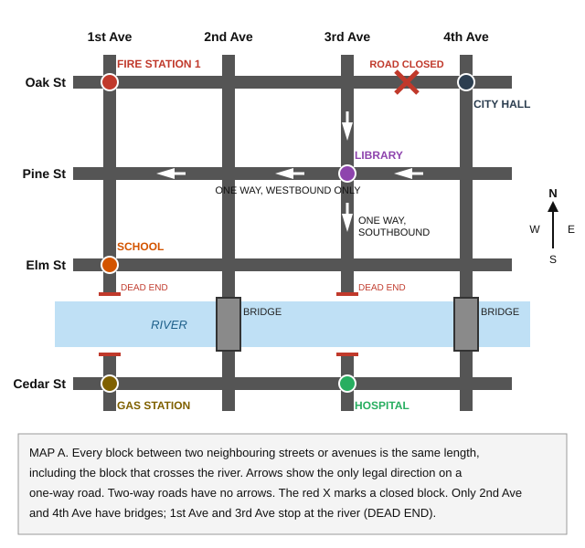
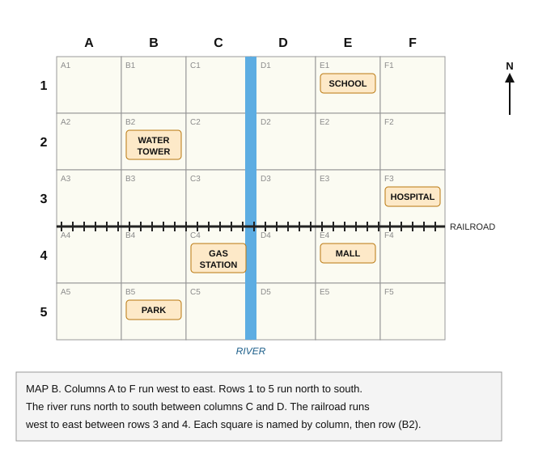

<!-- nav:top -->[Contents](../README.md#contents) · Previous: [The CritiCall test explained](test-overview.md) · Next: [Decision making and prioritization](sections/decision-making-and-prioritization.md)<!-- /nav:top -->

# 15-minute diagnostic

Thirty short items, three for each module group, to show you where to start. Set a timer for 15 minutes, answer everything without looking anything up, then check your answers and use the table at the bottom.

These items are original, written for these notes. They are not taken from CritiCall or any publisher's materials.

If you already know which modules your agency uses, you can skip straight to those guides. If you want a feel for the pace instead, take the [free CritiCall practice test on PrepClubs](https://prepclubs.com/free-practice-tests/criticall?utm_source=github&utm_medium=referral&utm_campaign=study-notes&utm_content=criticall).

## Part A: Decision making

Use the four decision rules from the [decision making guide](sections/decision-making-and-prioritization.md#the-four-rules) and choose Police, Fire, EMS or Utility. If you have not learned the rules yet, answer on instinct. That tells you something too.

**D1.** A streetlight has been flickering and is now completely out.

**D2.** A man is kicking in the windows of a parked car.

**D3.** A worker is stuck inside a stalled freight elevator.

Answers, Part A

**D1: Utility.** Streetlights are part of the electric power system in the Utility rule.

**D2: Police.** He is damaging someone else's property.

**D3: Fire.** A trapped person who needs to be freed goes to Fire under the rules, even though EMS feels natural.

## Part B: Data entry

**D4.** The cursor is in the City field. You press Tab once. Which field is it in now?
A. Address B. Zip C. Telephone D. License Plate

**D5.** Source: MORALES, INES, 555-0384. Which entry matches exactly?
A. MORALES, INES, 555-0348 B. MORALEZ, INES, 555-0384 C. MORALES, INES, 555-0384 D. INES, MORALES, 555-0384

**D6.** A caller says her number is "five five five, oh nine one seven". Which is it?
A. 555-0971 B. 555-0917 C. 555-9017 D. 555-0197

Answers, Part B

**D4: B. Zip.** The order is Address, City, Zip.

**D5: C.** A swaps 84 to 48. B spells the surname with a Z. D reverses first and last name.

**D6: B. 555-0917.**

## Part C: Call summarization

Call transcript for D7 to D9: open, read once, close

> "There's a kitchen fire at 15 Alder Court, apartment 2B, second floor. The smoke alarm's going off. My roommate's still in there trying to put it out with a towel. I'm outside on the sidewalk. I'm Marcus, 555-0261."

**D7.** Which apartment is on fire?
A. 2D B. 12B C. 2B D. The caller did not say

**D8.** Where is the caller now?
A. In the kitchen B. Outside on the sidewalk C. In the stairwell D. The caller did not say

**D9.** Who is still inside?
A. Nobody B. The caller's neighbor C. The caller's roommate D. A child

Answers, Part C

**D7: C. 2B.** **D8: B.** **D9: C.** If you missed any of these, the usual cause is reading for the story instead of capturing the facts as they come.

## Part D: Memory recall

Stimulus for D10 to D12: open, study for 15 seconds, close

| | |
|---|---|
| GOLD | TRUCK |
| BLACK | KAYAK |
| PINK | BICYCLE |
| Plate | 4JNV381 |

**D10.** Which word was paired with BLACK?
A. Truck B. Kayak C. Bicycle D. None

**D11.** What was the plate?
A. 4JVN381 B. 4JNV318 C. 4JNV381 D. 4NJV381

**D12.** Which color was paired with BICYCLE?
A. Gold B. Black C. Pink D. None

Answers, Part D

**D10: B. Kayak.** **D11: C. 4JNV381.** **D12: C. Pink.**

## Part E: Cross-referencing and perceptual ability

| Last name | First name | Unit | Phone |
|---|---|---|---|
| DUARTE | RAFAEL | 14 | 555-0560 |
| DUBOIS | CLAIRE | 9 | 555-0623 |
| DUNN | OWEN | 22 | 555-0417 |

**D13.** What is the phone number for DUBOIS, CLAIRE?
A. 555-0560 B. 555-0632 C. 555-0623 D. 555-0417

**D14.** Same or different? `82 WESTGATE BLVD` / `82 WESTGATE BLVD`

**D15.** Same or different? `5GHT902` / `5GTH902`

Answers, Part E

**D13: C. 555-0623.** **D14: Same.** **D15: Different.** HT and TH are swapped.

## Part F: Map reading and position locating

Use Map A for D16 and D17, and Map B for D18. The maps are on the [map reading guide](sections/map-reading-and-position-locating.md#how-the-questions-look).

**D16.** Which is the most direct legal route from the Library to the School?
A. West on Pine St to 1st Ave, south on 1st Ave to Elm St.
B. South on 3rd Ave to Elm St, west on Elm St to 1st Ave.
C. Both routes are equally direct and legal.
D. Neither route is legal.

**D17.** You are driving north on 4th Ave and turn left onto Elm St. Which direction are you now heading?
A. North B. East C. South D. West

**D18.** A caller is directly north of the Mall and just north of the railroad. Which square?
A. E3 B. E5 C. D3 D. F4

Answers, Part F

**D16: C.** Both are 3 blocks and both are legal: Pine St runs westbound and 3rd Ave runs southbound, which are the directions each route uses.

**D17: D. West.** Heading north, your left is west.

**D18: A. E3.** The Mall is in E4. Directly north is E3, which sits just north of the tracks.

## Part G: Probability and numerical ability

**D19.** Five callers describe a suspect's jacket: red, red, maroon, red, black. Most likely color?
A. Maroon B. Black C. Red D. Cannot tell

**D20.** A unit was dispatched at 09:48 and arrived at 10:03. Response time?
A. 15 minutes B. 25 minutes C. 55 minutes D. 13 minutes

**D21.** 20% of 150 calls were traffic calls. How many?
A. 20 B. 25 C. 30 D. 35

Answers, Part G

**D19: C. Red.** Three of five. **D20: A. 15 minutes.** 12 minutes to 10:00, plus 3. **D21: C. 30.**

## Part H: Reading comprehension and sentence clarity

> All radio transmissions are recorded, except internal maintenance channels. Recordings are kept for 90 days unless a supervisor flags them for an investigation, in which case they are kept until the investigation closes.

**D22.** How long is an ordinary recording kept?
A. 30 days B. 60 days C. 90 days D. Until the investigation closes

**D23.** Which transmissions are not recorded?
A. Emergency channels B. Internal maintenance channels C. Supervisor channels D. None

**D24.** Which is clearest?
A. Limping badly, the officer saw the suspect.
B. The officer saw the suspect, who was limping badly.
C. The officer, limping badly, saw the suspect, it seemed.
D. Badly limping, the suspect the officer saw.

Answers, Part H

**D22: C. 90 days.** **D23: B.** Look for the word "except". **D24: B.** The limp clearly belongs to the suspect.

## Part I: Spelling and proofreading

**D25.** The ___ were moved to the second ambulance.
A. patience B. patients C. patient's D. pashents

**D26.** Which is spelled correctly?
A. recieve B. receeve C. receive D. receve

**D27.** Which word fits? "The car rolled because the ___ was off."
A. brake B. break C. braek D. brayk

Answers, Part I

**D25: B. patients.** **D26: C. receive.** **D27: A. brake.**

## Part J: Situational judgment

**D28.** A caller is shouting at you about how long the ambulance is taking. Best response?
A. Tell him calmly what is happening and keep him on the line with instructions.
B. End the call, since he is being abusive.
C. Tell him the ambulance will be there in one minute so he calms down.
D. Shout back so he listens.

**D29.** You notice a mistake in an address you sent to a crew. Best response?
A. Correct it and tell the crew and your supervisor at once.
B. Wait to see if the crew notices.
C. Fix it in the record only.
D. Mention it at the end of your shift.

**D30.** Two calls arrive together: a cat stuck in a tree, and a person who is unconscious. Which first?
A. The cat B. The unconscious person C. Whichever came in first D. Neither until a supervisor decides

Answers, Part J

**D28: A.** Calm information and something useful to do. C promises what you cannot control. **D29: A.** **D30: B.** Threat to life comes first.

## What your result means

Count your correct answers in each part.

| Part | Your score | If you scored 0 or 1 | If you scored 2 | If you scored 3 |
|---|---|---|---|---|
| A. Decision making | /3 | Start with the [decision making guide](sections/decision-making-and-prioritization.md) | Drill the four rules | Light review only |
| B. Data entry | /3 | Start with the [data entry guide](sections/data-entry-and-keyboarding.md) | Learn the field order | Light review, then typing speed |
| C. Call summarization | /3 | Start with the [call summarization guide](sections/call-summarization.md) | Practice keyword notes | Light review only |
| D. Memory recall | /3 | Start with the [memory guide](sections/memory-recall.md) | Practice chunking | Light review only |
| E. Cross-referencing | /3 | Start with the [cross-referencing guide](sections/cross-referencing-and-perceptual-ability.md) | Practice comparing in chunks | Light review only |
| F. Maps | /3 | Start with the [map guide](sections/map-reading-and-position-locating.md) | Practice turns and one-way rules | Light review only |
| G. Probability and numbers | /3 | Start with the [numerical guide](sections/probability-and-numerical-ability.md) | Practice time arithmetic | Light review only |
| H. Reading and clarity | /3 | Start with the [reading guide](sections/reading-comprehension-and-sentence-clarity.md) | Watch for limiting words | Light review only |
| I. Spelling | /3 | Start with the [spelling guide](sections/spelling-and-proofreading.md) | Learn the confusable pairs | Light review only |
| J. Situational | /3 | Start with the [situational guide](sections/situational-judgment-and-personality.md) | Use the four-question check | Light review only |

Then pick a plan: the [7-day plan](study-plans.md#7-day-plan) if you have a week, or the [2-day plan](study-plans.md#2-day-plan) if the test is close. If your invitation lists which modules you will take, give those parts more weight than the rest.

---

<!-- nav:bottom -->← Previous: [The CritiCall test explained](test-overview.md) | Next: [Decision making and prioritization](sections/decision-making-and-prioritization.md) → | [Back to contents](../README.md#contents)<!-- /nav:bottom -->
